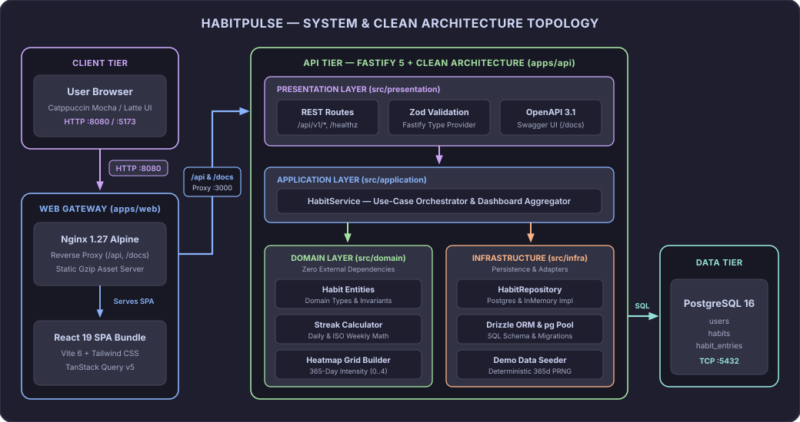
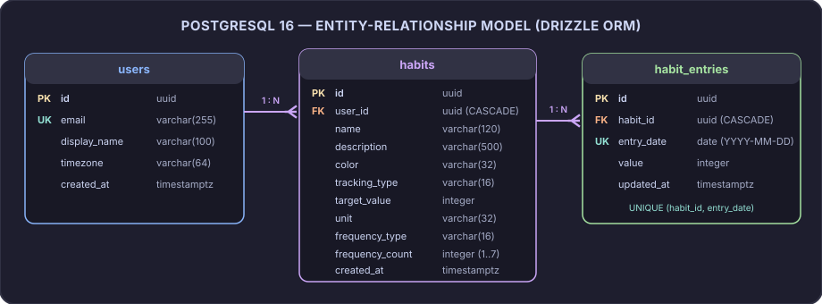
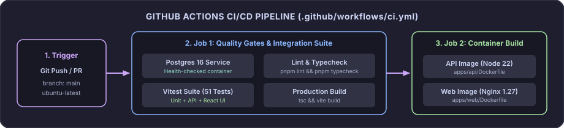

# HabitPulse ⚡

> **Distraction-free personal habit tracking engine & senior backend software engineering showcase.**  
> Built with Clean Architecture, Domain-Driven Design (DDD), Fastify, React, PostgreSQL 16, Catppuccin styling, Docker, Kubernetes, and GitHub Actions.

[](https://www.typescriptlang.org/)
[](https://nodejs.org/)
[](https://fastify.dev/)
[](https://react.dev/)
[](https://tailwindcss.com/)
[](https://www.postgresql.org/)
[](https://www.docker.com/)
[](https://kubernetes.io/)
[](https://github.com/)
[](https://github.com/catppuccin/catppuccin)

---

## 📖 Table of Contents

- [Overview](#-overview)
- [System Architecture](#-system-architecture)
- [Domain Engine & Mathematical Rigor](#-domain-engine--mathematical-rigor)
  - [Streak Calculation Engine](#streak-calculation-engine)
  - [Date Boundaries & Timezone Offset Safety](#date-boundaries--timezone-offset-safety)
  - [365-Day Heatmap Aggregator](#365-day-heatmap-aggregator)
- [Database Schema & ER Model](#-database-schema--er-model)
- [User Interface & Catppuccin Palette](#-user-interface--catppuccin-palette)
- [REST API Reference](#-rest-api-reference)
- [Local Development & Quickstart](#-local-development--quickstart)
- [Containerization (Docker Compose)](#-containerization-docker-compose)
- [Kubernetes Manifests (Production Setup)](#-kubernetes-manifests-production-setup)
- [CI/CD Pipeline](#-cicd-pipeline)
- [Repository Structure](#-repository-structure)

---

## 🌟 Overview

HabitPulse solves two distinct problems:

1. **For the User:** A minimalist, distraction-free daily companion to track boolean (done/not-done) and quantitative (e.g., "Read 20 pages") habits with weekly/daily frequencies, instant streak feedback, and GitHub-style 365-day consistency heatmaps, wrapped in the calming **Catppuccin Mocha** (dark) and **Catppuccin Latte** (light) palettes.
2. **For Engineering Evaluation:** A reference implementation demonstrating **modern software engineering excellence**:
   - **Clean Architecture & DDD:** Strict boundary enforcement where core domain calculation rules have zero dependencies on web frameworks or databases.
   - **Type Safety End-to-End:** Shared Zod schemas, Fastify Type Provider, and strict TypeScript across the monorepo.
   - **Testing Pyramid:** High-speed in-memory domain unit tests coupled with integration tests against real PostgreSQL queries via `pg-mem` and Dockerized Postgres.
   - **DevOps Maturity:** Multi-stage Alpine container images, non-root execution, Kubernetes probes (`/healthz` and `/readyz`), Ingress definitions, and GitHub Actions CI.

---

## 🏗 System Architecture

HabitPulse is organized as a `pnpm` monorepo containing the REST API service (`apps/api`) and the single-page application (`apps/web`).

<p align="center">
  
</p>

### Architectural Principles

- **Inversion of Control:** The Application and Domain layers define repository interfaces (`HabitRepository`). The Infrastructure layer provides the concrete PostgreSQL implementation using Drizzle ORM.
- **Portability:** Fastify app factory (`buildApp`) supports dependency injection of mock/in-memory repositories for sub-millisecond integration tests without requiring an active external database connection.
- **Graceful Lifecycle:** Clean shutdown hooks listening to `SIGINT` and `SIGTERM` drain in-flight HTTP requests and close PostgreSQL connection pools.

---

## 🧮 Domain Engine & Mathematical Rigor

### Streak Calculation Engine

Tracking streaks accurately across daily and weekly intervals requires non-trivial domain math:

1. **Daily Frequency (`daily`):**
   - A habit is expected every calendar day.
   - For **boolean** habits: completed when `value >= 1`.
   - For **quantitative** habits: completed when `value >= targetValue`.
   - **Active Streak Logic:** If today is not yet completed, the streak remains intact if yesterday was completed (the user still has until midnight to complete today).
   - **Historical Best Streak:** The maximum consecutive sequence of satisfied days over the entire history.

2. **Weekly Frequency (`weekly`):**
   - A habit is expected `N` days per ISO calendar week (`1 <= N <= 7`, e.g., "Strength Training 4x/week").
   - Each calendar week (Monday to Sunday) is evaluated as a window:
     ```text
     Week Completed  <==>  count(completed days in ISO Week Mon..Sun) >= N
     ```
   - **Current Streak:** Consecutive successfully completed ISO weeks leading up to the current week. If the current week is in progress and has not yet reached `N` completions, it does **not** break the active streak from preceding weeks.

3. **30-Day Completion Rate:**
   ```text
   Rate_30d = round((Completed Days in 30d Window / 30) * 100)
   ```

### Date Boundaries & Timezone Offset Safety

A classic trap in habit tracking applications is storing calendar logs with `TIMESTAMPTZ` and letting UTC offsets convert `2026-11-11 00:30:00` into the previous day in another timezone.

HabitPulse solves this deterministically:
- All dates are stored as PostgreSQL `DATE` types (`YYYY-MM-DD`).
- The API accepts explicit client calendar dates (`referenceDate=YYYY-MM-DD`).
- The domain calculator processes date strings using ISO-8601 calendar arithmetic, guaranteeing that a habit logged on Tuesday remains on Tuesday everywhere.

### 365-Day Heatmap Aggregator

The backend computes a full 365-day grid organized into 52 ISO weeks:
- Mon–Sun 7-day columns matching standard contribution graph geometry.
- 5 intensity levels:
  - `Level 0`: No activity (`value = 0`).
  - `Level 1`: Partial progress (`0 < ratio < 0.5`).
  - `Level 2`: Significant progress (`0.5 <= ratio < 1.0`).
  - `Level 3`: Target achieved (`ratio = 1.0`).
  - `Level 4`: Target exceeded (`ratio > 1.0`).

---

## 🗄 Database Schema & ER Model

<p align="center">
  
</p>

- **Relational Integrity:** Cascading deletes on `habits` and `habit_entries`.
- **Multi-Tenant Foundation:** All tables contain foreign keys to `users.id`.
- **Unique Constraint:** `(habit_id, entry_date)` has a compound unique index for atomic upserts (`ON CONFLICT (habit_id, entry_date) DO UPDATE`).

---

## 🎨 User Interface & Catppuccin Palette

HabitPulse implements the official [Catppuccin](https://github.com/catppuccin/catppuccin) color system:

| Role | Mocha (Dark - Default) | Latte (Light) |
|---|---|---|
| **Base (Background)** | `#1e1e2e` | `#eff1f5` |
| **Mantle (Cards / Containers)** | `#181825` | `#e6e9ef` |
| **Surface0 (Borders / Inputs)** | `#313244` | `#ccd0da` |
| **Text (Primary Typography)** | `#cdd6f4` | `#4c4f69` |
| **Subtext0 (Secondary Muted)** | `#a6adc8` | `#6c6f85` |

### 14 Curated Accent Tokens
Each habit is assigned one of 14 Catppuccin accent colors:  
`mauve` (`#cba6f7`), `pink` (`#f5c2e7`), `lavender` (`#b4befe`), `red` (`#f38ba8`), `maroon` (`#eba0ac`), `peach` (`#fab387`), `yellow` (`#f9e2af`), `green` (`#a6e3a1`), `teal` (`#94e2d5`), `sky` (`#89dceb`), `sapphire` (`#74c7ec`), `blue` (`#89b4fa`), `flamingo` (`#f2cdcd`), and `rosewater` (`#f5e0dc`).

The user interface automatically persists theme choices in `localStorage` and provides high contrast accessibility across both palettes.

---

## 📡 REST API Reference

All application endpoints are versioned under `/api/v1`. OpenAPI 3.1 definitions and the interactive Swagger UI are available at `/docs`.

| Method | Endpoint | Description |
|---|---|---|
| `GET` | `/healthz` | Kubernetes liveness probe (returns `200 OK`) |
| `GET` | `/readyz` | Kubernetes readiness probe (verifies database pool connectivity) |
| `GET` | `/docs` | Interactive Swagger UI (OpenAPI 3.1 specification) |
| `GET` | `/api/v1/dashboard?date=YYYY-MM-DD` | Returns aggregate summary metrics, week dates, and all habits with stats |
| `GET` | `/api/v1/habits` | List all habits for the authenticated user |
| `POST` | `/api/v1/habits` | Create a new habit (validated with Zod) |
| `DELETE` | `/api/v1/habits/:id` | Delete a habit and all associated historical entries |
| `PUT` | `/api/v1/habits/:id/entries/:date` | Upsert entry progress for a specific calendar date |
| `GET` | `/api/v1/habits/:id/heatmap?days=365` | Retrieve 365-day heatmap cell grid with 0–4 intensity levels |
| `POST` | `/api/v1/demo/seed` | Idempotently resets and populates 5 realistic habits and 365 days of demo data |

---

## 💻 Local Development & Quickstart

### Prerequisites
- **Node.js:** `>= 22.0.0`
- **pnpm:** `>= 10.0.0`
- **Docker & Docker Compose** (optional, for containerized execution)

### 1. Clone & Install Dependencies
```bash
git clone https://github.com/espfrant/habitpulse.git
cd habitpulse
pnpm install
```

### 2. Start PostgreSQL
```bash
docker run -d --name habitpulse-dev-pg \
  -e POSTGRES_USER=postgres \
  -e POSTGRES_PASSWORD=postgres \
  -e POSTGRES_DB=habitpulse \
  -p 5432:5432 postgres:16-alpine
```

### 3. Start Development Servers
```bash
pnpm dev
```
- **Web App:** [http://localhost:5173](http://localhost:5173) (Vite dev server with `/api` proxy)
- **API Server:** [http://localhost:3000](http://localhost:3000)
- **OpenAPI Docs:** [http://localhost:3000/docs](http://localhost:3000/docs)

### 4. Workspace Verification Commands
```bash
# Typecheck all TypeScript workspaces
pnpm typecheck

# Run unit tests and PostgreSQL integration tests
pnpm test

# Build production bundles for API and Web
pnpm build

# Run monorepo linting
pnpm lint
```

---

## 🐳 Containerization (Docker Compose)

Launch the entire stack (PostgreSQL 16, Fastify API, and Nginx SPA) in one command:

```bash
docker compose up --build
```

### Services Started:
- **`postgres`:** PostgreSQL 16 Alpine with persistent volume `postgres_data` (Port `5432`).
- **`api`:** Multi-stage Node 22 Alpine production container (Port `3000`).
- **`web`:** Multi-stage Nginx 1.27 Alpine web server with reverse-proxy routing (Port `8080`).

### Access Points:
- Web Application: [http://localhost:8080](http://localhost:8080)
- REST API: [http://localhost:8080/api/v1/dashboard](http://localhost:8080/api/v1/dashboard)
- OpenAPI Documentation: [http://localhost:8080/docs](http://localhost:8080/docs)

---

## ☸️ Kubernetes Manifests (Production Setup)

Declarative, cloud-native Kubernetes manifests reside in `k8s/`:

```
k8s/
├── 00-namespace.yaml    # Dedicated 'habitpulse' namespace
├── 01-postgres.yaml     # PostgreSQL StatefulSet, PVC (1Gi), Secret, and Service
├── 02-api.yaml          # Fastify API Deployment (2 replicas), ConfigMap, and Service
├── 03-web.yaml          # Nginx Web SPA Deployment (2 replicas) and Service
└── 04-ingress.yaml      # Nginx Ingress Controller routing rules (/api, /docs, /)
```

### Deploy to a Kubernetes Cluster:
```bash
kubectl apply -f k8s/00-namespace.yaml
kubectl apply -f k8s/01-postgres.yaml
kubectl apply -f k8s/02-api.yaml
kubectl apply -f k8s/03-web.yaml
kubectl apply -f k8s/04-ingress.yaml
```

### Cloud-Native Resilience Features:
- **Zero-Downtime Rolling Updates:** Multiple replicas on both `api` and `web` deployments.
- **Liveness Probes:** Fastify `/healthz` probe verifies process responsiveness.
- **Readiness Probes:** Fastify `/readyz` probe tests database socket connectivity before traffic is routed.
- **Resource Governance:** Explicit CPU/Memory `requests` and `limits` prevent noisy-neighbor container eviction.

---

## 🔄 CI/CD Pipeline

The GitHub Actions workflow (`.github/workflows/ci.yml`) runs automatically on pushes and pull requests:

<p align="center">
  
</p>

1. **Service Container:** Spins up a true `postgres:16-alpine` instance with health checks.
2. **Quality Gates:** Executes `pnpm lint`, `pnpm typecheck`, and Vitest test suites.
3. **Build Check:** Compiles TypeScript artifacts and builds the Vite SPA bundle.
4. **Container Build Verification:** Builds both Docker images using Docker Buildx to guarantee image reproducibility.

---

## 📁 Repository Structure

```
habitpulse/
├── .github/
│   └── workflows/
│       └── ci.yml               # GitHub Actions CI pipeline
├── apps/
│   ├── api/                     # Backend Fastify Service
│   │   ├── src/
│   │   │   ├── application/     # Application use-case orchestrators (HabitService)
│   │   │   ├── config/          # Environment configuration
│   │   │   ├── domain/          # Pure domain logic (entities, streak math, heatmaps)
│   │   │   ├── infrastructure/  # PostgreSQL repository, Drizzle schema, migrations, seeder
│   │   │   ├── presentation/    # REST routes, Zod schemas, OpenAPI specs
│   │   │   ├── app.ts           # Fastify application factory
│   │   │   └── server.ts        # Production entrypoint & graceful shutdown
│   │   ├── test/                # Unit and integration test suites
│   │   ├── Dockerfile           # Multi-stage production container build
│   │   └── package.json
│   └── web/                     # Frontend React 19 SPA
│       ├── src/
│       │   ├── api/             # Typed API fetch client & query hooks
│       │   ├── components/      # Header, SummaryCards, WeeklyMatrix, Heatmap, Modals
│       │   ├── theme/           # Catppuccin Mocha & Latte color tokens
│       │   ├── App.tsx          # Main dashboard view
│       │   └── main.tsx         # React root mounting
│       ├── test/                # Frontend testing library test suite
│       ├── Dockerfile           # Multi-stage Vite build -> Nginx static server
│       ├── nginx.conf           # Reverse proxy configuration (/api, /docs)
│       └── package.json
├── k8s/                         # Kubernetes manifests
│   ├── 00-namespace.yaml
│   ├── 01-postgres.yaml
│   ├── 02-api.yaml
│   ├── 03-web.yaml
│   └── 04-ingress.yaml
├── docs/                        # Architecture specs and plans
├── docker-compose.yml           # Local full-stack execution
├── package.json                 # Monorepo root manifest
└── pnpm-workspace.yaml          # pnpm workspace configuration
```

---

## 📄 License

MIT © [HabitPulse Contributors](LICENSE)
